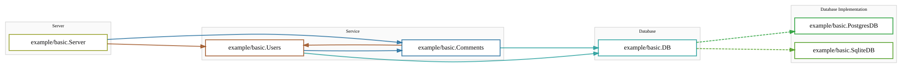
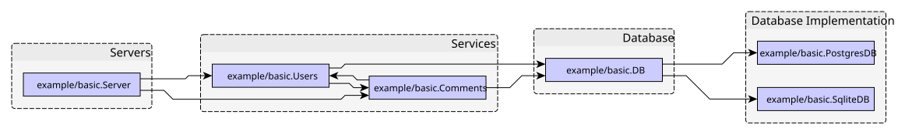

# ArchView

ArchView is a tool for creating and inspecting Go program architecture based on annotations.

## Introduction

To start using, add annotations like so:

```go
package example

// architecture: Database
type DB interface {
	Query() string
}

// architecture: Service
type Users struct {
	db       DB
	comments *Comments
}

// architecture: Service
type Comments struct {
	db    DB
	users *Users
}

// architecture: Server
type Server struct {
	comments *Comments
	users    *Users
}

// we can create links between interfaces and implementations with idiomatic Go
var _ DB = &PostgresDB{}
var _ DB = (*SqliteDB)(nil)

// architecture: Database Implementation
type PostgresDB struct{}

func (*PostgresDB) Query() string { return "postgres" }

// architecture: Database Implementation
type SqliteDB struct{}

func (*SqliteDB) Query() string { return "sqlite" }
```

When we run the tool to output a graphviz `dot` file:

```
archview ./... | dot -Tsvg > graph.svg
```



We can also use more complicated tools, by outputting a graphml file:

```
archview -out example.graphml ./... 
```

With a tool like [yEd](https://yed.yworks.com) we can try different ways of visualizing:



## Install

To install archview run:

```
go install github.com/storj/archview@latest
```

You'll also need a tool to layout the graph, for example:

1. [GraphViz](https://www.graphviz.org/) for `dot` formats.
2. [yEd](https://yed.yworks.com) for `graphml` formats.

Running the tool outputs the graph definition:

```
archview [-format (dot|dot-basic|graphml|elk)] [-out <output file>] [packages]
```

## Output and filtering

By default, ArchView writes DOT to standard output. `-out graph.graphml` selects
GraphML from the file extension; an explicit `-format` takes precedence.
`dot` includes styling and class clusters, `dot-basic` produces a minimal directed
graph, `graphml` includes metadata and yEd labels, and `elk` produces ELK text.

| Flag | Behavior |
| --- | --- |
| `-root example.Server` | Keep the named component and its transitive dependencies. Unknown names produce an error listing available components. |
| `-skip-class Service` | Remove components of the given class and links to them. Applied after root selection. |
| `-trim-prefix example.` | Shorten displayed names without merging distinct components. |
| `-cluster class` | Group DOT nodes by class (the default). Use `-cluster=''` to disable grouping. |
| `-nocolor` | Disable DOT coloring. |

`-root` and `-skip-class` accept repeated flags or comma-separated values.
Root names use fully qualified type names, before prefix trimming. Quote names
containing spaces. For example, with module path `example`:

```sh
archview -root example.Server -skip-class 'Database Implementation' -trim-prefix example. ./...
archview -cluster='' -nocolor ./... | dot -Tsvg > graph.svg
archview -format elk -out graph.elkt ./...
```

Package errors and invalid options are reported before the output file is opened.
File output is written to a temporary file in the destination directory, synced,
and closed before replacing the destination using a rename. Replacement is atomic
on platforms that support atomic file renames. Existing file permissions are
preserved; new files are private to the current user on Unix. Symlinks and other
non-regular destinations are rejected. Standard output is streamed directly.

## Dependency rules

Place `// architecture: Class` above a type declaration or an individual type
inside a grouped declaration. A group annotation applies to its types unless a
type has its own annotation.

ArchView follows struct fields, including nested unannotated structs, aliases,
multiple pointer levels, arrays, slices, channel elements, and both map keys and
values. It also follows parameters and results of interface methods and function
types, including callback fields and variadic parameters.

Generic instances link to the annotated generic declaration: a field of type
`*Cache[int]` links to `Cache[T]`. Traversal stops when an annotated component is
reached. Repeated references to the same target along the same field or method
path produce one dependency link; separate fields remain separate links.

An annotated alias is a separate component: references to that alias link to it,
while references to the original type keep linking to the original component.
Unannotated aliases resolve to their targets. This also applies to generic aliases.

Explicit interface assignments such as `var _ DB = (*PostgresDB)(nil)` create
implementation links. ArchView does not infer every possible interface
implementation, analyze function bodies as call graphs, or inspect concrete
methods merely because their receiver is annotated.

Assignments between identical interface types (including aliases) do not create
implementation links. Repeated assertions for the same component pair produce
one implementation link, independently of any ordinary dependency links.

## Explicit relationships

Use a standalone line comment to describe a relationship that Go type references
do not express:

```go
// architecture:link Client -> Server : sends requests
// architecture:link Server -> example/worker.Worker : dispatches jobs
```

The syntax is `// architecture:link Source -> Target` with an optional `: label`.
Separate the arrow and colon from endpoint names with spaces. Labels may contain
multiple words. A bare type name refers to an annotated type in the comment's
package; a qualified name uses the full import path followed by the type name.
Use generic declaration names without type parameters, such as `Cache`.

Endpoints must be annotated types or declared external resources in the loaded packages. Forward
references and cycles are supported. Identical explicit links are deduplicated;
different labels and inferred dependencies remain separate. Malformed directives,
unknown endpoints, and ambiguous names report source locations and stop output.

Explicit links participate in root selection and class filtering. DOT and GraphML
include relationship labels (including yEd edge graphics); ELK retains the
connections without labels. The yEd encoding follows the
[PolyLineEdge schema](https://www.yworks.com/xml/schema/graphml/1.1/doc/http___www.yworks.com_xml_graphml/element/PolyLineEdge.html).

### External resources and database tables

Declare resources that have no Go type with `architecture:resource`. Resource IDs
start with `external:` and contain no whitespace. IDs are global across the loaded
packages; a class may contain spaces. For example:

```go
// architecture: Database Implementation
type Postgres struct{}

// architecture:resource external:users : Database Table
// architecture:resource external:comments : Database Table
// architecture:link Postgres -> external:users : reads and writes
// architecture:link Postgres -> external:comments : reads and writes
// architecture:link external:comments -> external:users : references
```

Directives may appear anywhere in a Go source file, including a dedicated
`architecture.go` file. Resources can be either endpoint of a link, and do not
require wrapper types, imports, or runtime code. Identical declarations share one
resource; conflicting classes for the same ID are errors. Undeclared resources
are errors, so a misspelled target cannot silently create a new node.

External resources appear in every output format, without Go documentation URLs.
Use `-root external:users` to select a resource, or `-skip-class 'Database Table'`
to hide tables. See [the database/table example](testdata/tables/db.go).
